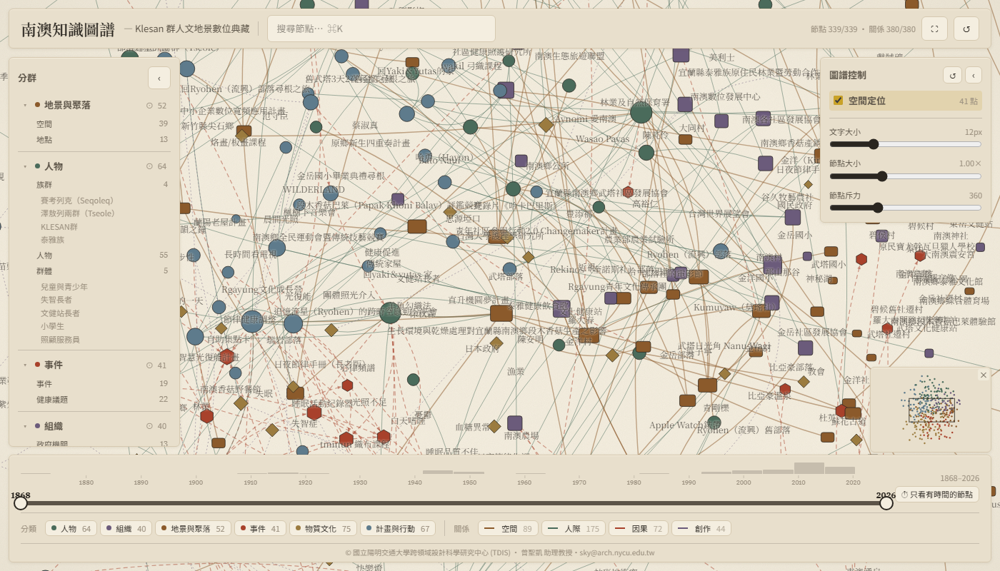

# 南澳知識圖譜

<p align="center"></p>

[English](README.md) ｜ [交接說明](docs/專案說明.md)

這是一個互動網站，把宜蘭南澳 Klesan 群的人物、地點、事件與故事，畫成一張彼此相連的關係圖。圖上每個圓點叫「**節點**」，代表一個人物、地點、物件或事件；每條線叫「**連線**」，代表兩個節點之間的關係。點任一個圓點，就能看到它的說明文字。

- 網址：https://tdis-design.github.io/nanao/
- 製作單位：國立陽明交通大學 跨領域設計科學研究中心（TDIS）
- 計畫主持人：曾聖凱
- 資料：在 Google 試算表 `graphdata` 編輯（2026 年 11 月約 290 個節點、370 條連線）

## 給誰看

本專案主要由研究人員與文字工作者維護。**更新內容完全不需要碰程式**，所有文字都在 Google 試算表裡編輯。

## 怎麼更新內容

1. 開啟雲端硬碟「For Website」資料夾裡的試算表 `graphdata`（連結請向計畫主持人索取）。
2. 編輯 `nodes_ALL`（節點）與 `link_ALL`（連線）分頁。一列就是一個節點或一條連線。
3. 選單「圖譜工具」→「檢查資料（不推送）」，把標色的格子修正。
4. 選單「圖譜工具」→「推送 graph.json 到網站」。試算表會把資料送到本 GitHub 專案，存成 `data/graph.json`。
5. GitHub 會自動重新產生網站。約等 5 分鐘，再按 **Ctrl + Shift + R** 重新整理網頁。

超過 10 分鐘網站還是舊的，請看交接說明的「常見問題」。

## 網站功能

- 用名稱搜尋節點。
- 用時間軸拉桿只看某個年代。
- 顯示或隱藏某類關係。
- 側欄依分類整理節點。
- 分享畫面：網址會記住目前的選擇，例如 `?node=武塔&years=1900-2000`，把網址傳給別人就能看到同一個畫面。

## 資料夾說明

| 資料夾或檔案 | 內容 | 可以手動改嗎 |
|---|---|---|
| `data/graph.json` | 網站顯示的內容 | 不要。由 Google 試算表自動寫入。 |
| `data/source.xlsx` | 離線作業用的 Excel 資料。不放在 GitHub 上，請另存在實驗室雲端硬碟。 | 只在離線作業時用 |
| `docs/` | 交接說明與圖片 | 可以 |
| `src/` | 網站程式 | 限工程師 |
| `scripts/` | Excel 轉 JSON 的程式 | 限工程師 |
| `apps_script/` | 試算表裡小程式的備份，以及 Token 設定說明 | 限工程師 |
| `public/`、`index.html`、`media/` | 網頁與靜態檔案 | 限工程師 |
| `package.json`、`package-lock.json`、`vite.config.js`、`.github/` | 網站建置與發布設定 | 限工程師 |
| `南澳知識圖譜_詳細規劃_v2.md` | 原始規劃文件（`南澳知識圖譜_詳細規劃_v1.md` 為較早版本） | 參考用 |
| `LICENSE`、`LICENSE-CONTENT.md`、`CITATION.cff` | 授權與引用資訊 | 很少需要 |

## 給工程師

```bash
npm install
npm run dev        # 本機預覽 http://localhost:5173
npm run build      # 建置到 dist/
npm run data       # 從 data/source.xlsx 重建 data.json（需 Python 3 與 openpyxl）
```

每次推送到 `main`，`.github/workflows/deploy.yml` 會自動建置並發布到 GitHub Pages。

## 參與人員

| 角色 | 姓名 |
|---|---|
| 單位 | 國立陽明交通大學 跨領域設計科學研究中心（TDIS） |
| 計畫主持人 | 曾聖凱 |
| 田野調查 | |
| 文字撰寫與編輯 | |
| 資料整理 | |
| 網站設計與開發 | |
| 社區夥伴與顧問 | |

## 引用方式

> 曾聖凱、國立陽明交通大學跨領域設計科學研究中心（TDIS）（2026）。《南澳知識圖譜》［網站］。https://tdis-design.github.io/nanao/

機器可讀的引用資料在 [`CITATION.cff`](CITATION.cff)。

## 授權

- **程式碼**（`src/`、`scripts/`、設定檔）：[MIT 授權](LICENSE)。
- **內容**（文字、`data/` 內的資料、`docs/` 與 `public/` 內的圖片）：[創用 CC 姓名標示－非商業性 4.0 國際（CC BY-NC 4.0）](LICENSE-CONTENT.md)。只要標明出處、不做商業用途，就可以分享與改作。
- 由個人、家族或社區提供的照片與文件，著作權仍屬原提供者；再利用前請先取得同意。
- 本專案記錄 Klesan 群與在地社群的知識。再利用時請尊重社群意願；研究與教學以外的用途，請先聯絡 TDIS。

## 聯絡

國立陽明交通大學 跨領域設計科學研究中心（TDIS）
30010 新竹市東區大學路 1001 號 工程一館 207 室
03-5712121 分機 58472 ｜ tdis@nycu.edu.tw ｜ https://tdis.nycu.edu.tw/

相關專案：[竹東知識圖譜](https://github.com/tdis-design/zhudong)，使用同一套系統。
