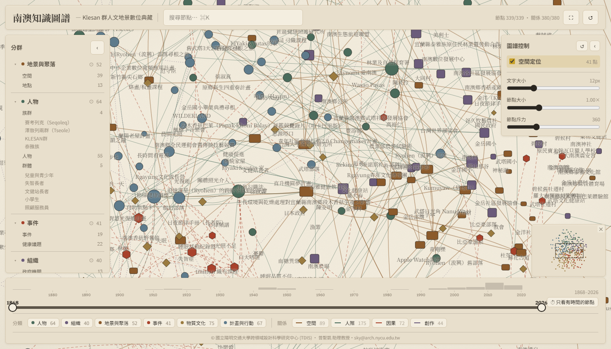

# Nan-ao Knowledge Graph (南澳知識圖譜)

<p align="center"></p>

[繁體中文說明](README-zh.md) ｜ [Handover notes (中文)](docs/專案說明.md)

An interactive website that shows the people, places, events and stories of the Klesan group in Nan-ao (Yilan, Taiwan) as a connected map. Each dot (a **node**) is one person, place, object or event. Each line (a **link**) is a relationship between two nodes. Click any dot to read its description.

- Website: https://tdis-design.github.io/nanao/
- Produced by: Transdisciplinary Design Innovation Shop (TDIS), National Yang Ming Chiao Tung University (NYCU)
- Principal investigator: Sheng-Kai Tseng (曾聖凱)
- Data: edited in the Google Sheet `graphdata` (about 290 nodes and 370 links as of November 2026)

## Who this is for

This project is maintained mainly by researchers and writers, not programmers. **You do not need to touch any code to update the content.** All text is edited in a Google Sheet.

## How to update the content

1. Open the Google Sheet `graphdata` in the project's Google Drive folder "For Website". (Ask the project lead for the link.)
2. Edit the `nodes_ALL` (nodes) and `link_ALL` (links) tabs. Each row is one node or one link.
3. In the Sheet's menu, choose 圖譜工具 → 檢查資料（不推送） (check only) and fix any coloured cells.
4. Choose 圖譜工具 → 推送 graph.json 到網站 (publish). The Sheet sends the data to this GitHub repository as `data/graph.json`.
5. GitHub rebuilds the website automatically. Wait about 5 minutes, then reload the page with **Ctrl + Shift + R**.

If the website does not change after 10 minutes, see the handover notes, section "Common problems".

## What the website can do

- Search for a node by name.
- Filter by time period with the timeline slider.
- Show or hide relationship types.
- Group nodes by category in the side panel.
- Share a view: the address bar keeps your current selection, for example `?node=武塔&years=1900-2000`.

## Folder guide

| Folder or file | What it holds | Edit by hand? |
|---|---|---|
| `data/graph.json` | The content shown on the website | No. The Google Sheet writes it. |
| `data/source.xlsx` | Excel copy of the data for offline work. Not stored on GitHub; keep it on the lab drive. | Only for offline work |
| `docs/` | Handover notes and images | Yes |
| `src/` | Website program code | Programmers only |
| `scripts/` | Converts Excel to JSON | Programmers only |
| `apps_script/` | Copy of the program inside the Google Sheet, and token setup guide | Programmers only |
| `public/`, `index.html`, `media/` | Website pages and static files | Programmers only |
| `package.json`, `package-lock.json`, `vite.config.js`, `.github/` | Website build and publishing settings | Programmers only |
| `南澳知識圖譜_詳細規劃_v2.md` | Original planning document (`南澳知識圖譜_詳細規劃_v1.md` is the earlier draft) | Reference |
| `LICENSE`, `LICENSE-CONTENT.md`, `CITATION.cff` | License and citation information | Rarely |

## For programmers

```bash
npm install
npm run dev        # local preview at http://localhost:5173
npm run build      # build into dist/
npm run data       # rebuild data.json from data/source.xlsx (needs Python 3 + openpyxl)
```

Every push to `main` runs `.github/workflows/deploy.yml`, which builds the site and publishes it to GitHub Pages.

## Credits

| Role | Name |
|---|---|
| Institution | Transdisciplinary Design Innovation Shop (TDIS), National Yang Ming Chiao Tung University |
| Principal investigator | Sheng-Kai Tseng (曾聖凱) |
| Field research | |
| Content writing and editing | |
| Data management | |
| Website design and development | |
| Community partners and advisors | |

## How to cite

> Tseng, S.-K., & Transdisciplinary Design Innovation Shop (TDIS), National Yang Ming Chiao Tung University. (2026). *Nan-ao Knowledge Graph* [Website]. https://tdis-design.github.io/nanao/

Machine-readable citation data is in [`CITATION.cff`](CITATION.cff).

## License

- **Program code** (`src/`, `scripts/`, configuration files): [MIT License](LICENSE).
- **Content** (text, data in `data/`, images in `docs/` and `public/`): [Creative Commons Attribution-NonCommercial 4.0 International (CC BY-NC 4.0)](LICENSE-CONTENT.md). You may share and adapt it for non-commercial purposes if you credit the source.
- Photos and documents supplied by individuals, families or communities remain the property of their original owners. Ask before reusing them.
- This project records knowledge of the Klesan group and local communities. Please respect the communities' wishes when you reuse it, and contact TDIS first for any use beyond research and education.

## Contact

Transdisciplinary Design Innovation Shop (TDIS), National Yang Ming Chiao Tung University
Room 207, Engineering Building 1, 1001 University Road, Hsinchu 30010, Taiwan
tdis@nycu.edu.tw ｜ https://tdis.nycu.edu.tw/

Related project: [Zhudong Knowledge Graph](https://github.com/tdis-design/zhudong), built on the same system.
